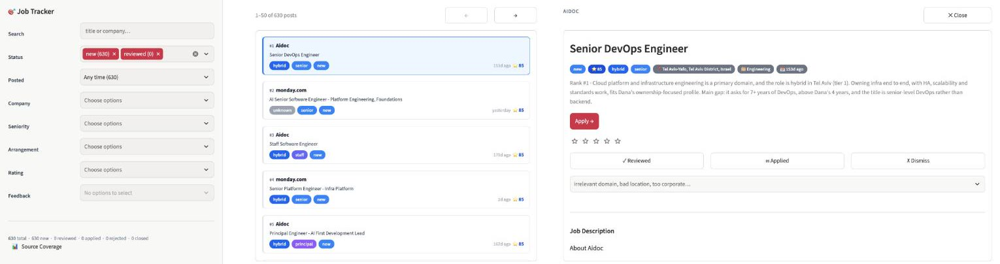
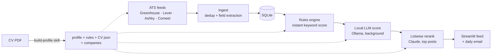
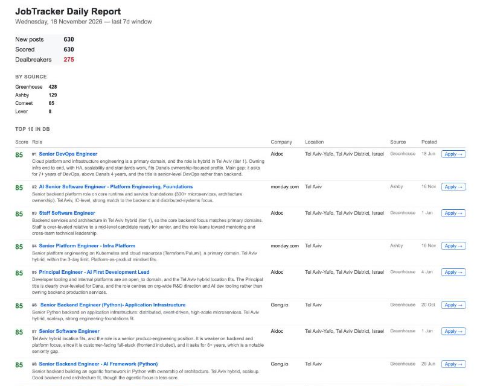

# JobPostTracker

Your own job feed. It collects open positions from companies matched to your profile, scores each
one against your CV and preferences, and puts the best matches on top with a short reason for each.
It runs on your machine and comes with a small [eval suite](#evals) that measures how well each
step works.

## What you can do with it

- **See every open role at companies matched to your profile** in one feed, pulled from their
  public job boards (Greenhouse, Lever, Ashby, Comeet). Nothing is silently dropped.
- **Get them ranked for you.** Every post is scored against a profile built from your CV, and the
  strongest ones are reranked with a one-line reason, gaps included ("Main gap: it asks for
  7+ years of DevOps").
- **Triage quickly.** Filter by seniority, work mode, company and date; rate posts, tag why they
  miss, and track what you applied to.
- **Get a daily email** with the new posts and the top matches (optional).

## Getting there

| Step | What you get | You need |
|---|---|---|
| 1. [Try the demo](#quick-start-the-demo-2-minutes) | A scored, ranked feed for a fictional engineer, in 2 minutes | Python 3.10+ |
| 2. [Make it yours](#use-it-for-yourself) | Your profile and matching companies from your CV, the daily pipeline (fetch, score, rerank), your ranked feed | [Claude Code](https://claude.com/claude-code) on a paid Claude plan (or edit the templates by hand and skip reranking); optional: [Ollama](https://ollama.com) for LLM scores |
| 3. [Run it on a schedule](#the-daily-pipeline) | The pipeline every morning, plus an optional email report | cron; a Gmail app password for the email |

**What it costs.** Browsing the demo, keyword scoring and local LLM scoring
([Ollama](https://ollama.com)) are free. The Claude steps run through the Claude Code CLI and are
billed to **your paid Claude subscription** (a plan that includes Claude Code, such as Pro or Max):
building your profile from a CV, reranking the top posts, optional Claude rescoring and the
LLM-judge evals. There is no separate API key. Without a subscription, edit the profile templates
by hand and skip reranking; the feed still works on rules and Ollama scores.



## Quick start: the demo (2 minutes)

Requires Python 3.10+.

```bash
git clone https://github.com/omergeiger/jobtracker-llm.git && cd jobtracker-llm
python3 -m venv .venv && source .venv/bin/activate
pip install -r requirements.txt
JOBTRACKER_HOME=examples/dana_example streamlit run ui/app.py
```

The demo persona, *Dana Example*, is a fictional mid-level backend engineer in Tel Aviv
(`examples/dana_example/cv.pdf`). The demo database holds 630 real public postings from Israeli tech
companies, scored for Dana by a local LLM, with the top 25 reranked. No Ollama, no Claude subscription
and no `.env` needed to browse it.

## Use it for yourself

1. **Run the build-profile skill on your CV.** In [Claude Code](https://claude.com/claude-code),
   from the repo folder, run `/build-profile path/to/your_cv.pdf`. It reads the CV, asks five
   short questions a CV can't answer (target roles, location and office days, domains,
   dealbreakers, companies to include or skip), suggests companies matched to your profile and
   verifies each one's job board. You confirm the list once. It writes four files to `resources/`
   (gitignored) and checks them with `scripts/check_profile.py`:
   - `cv_structured.json`: the structured CV
   - `user_profile.yaml`: plain-language preferences for the LLMs
   - `scoring_rules.yaml`: keywords and points for the rules engine
   - `companies.yaml`: the companies to fetch, per ATS; edit it any time

   No Claude Code? Copy `resources/templates/*.yaml` to `resources/`, edit them by hand, and find
   job-board slugs with `python scripts/probe_companies.py "Company A" "Company B"`.
2. **Run the daily pipeline (fetch, score, rerank):** `./scripts/run_pipeline.sh --dry-run`.
   `--dry-run` skips the email, so no Gmail setup is needed. What it runs is described
   [below](#the-daily-pipeline). Rules scores are instant; if [Ollama](https://ollama.com) is
   running with `qwen2.5:7b`, LLM scores follow (about 3 s per post); reranking needs the `claude`
   CLI.
3. **Open your ranked feed (local Streamlit):** `streamlit run ui/app.py`.

To keep several profiles, point `JOBTRACKER_HOME` at a folder holding the profile files plus its
own `jobtracker.db`; that's exactly what `examples/dana_example/` is (it has no `companies.yaml`, so
it falls back to the shipped company registry in `sourcing/source_registry/`).

## How it works



1. **Fetch** open positions from the public ATS feed of each company in `companies.yaml`.
2. **Ingest**: dedup by company, title and normalized URL; rule-based extraction of work mode,
   office days and seniority. The raw description is always kept.
3. **Score**: a local LLM (Qwen 2.5 7B via Ollama) scores every post against your profile, with an
   explanation per post. A keyword rules engine (from your `scoring_rules.yaml`: domain, location
   tiers, seniority, bonus signals, dealbreakers) scores first, instantly, and is the fallback
   whenever no LLM is available.
4. **Rerank**: the strongest recent posts are ranked against each other by Claude in a few
   listwise calls, each with a one-line rationale.
5. **Review** in the UI: ranked and full feeds, filters, 1-5 star ratings, reusable feedback
   tags, status tracking. An optional daily email summarizes new top posts.

## Principles

- **Recall first, then ranking.** No post is silently dropped: every fetched post is stored,
  scored and filterable. Ranking decides what you read first, not what you get to see.
- **Your preferences are config, not code.** Everything about the candidate, including which
  companies to watch, lives in a few files generated from a CV; the code only reads them.
- **No API keys to buy.** Core scoring runs on a fast keyword engine and a local LLM (Ollama),
  both free. The Claude steps use the Claude Code CLI on your paid Claude subscription; the
  HuggingFace free tier is an alternative scorer.
- **Small and boring on purpose.** SQLite, a few hundred posts a day, plain Python.

## Scoring engines

| Engine | Where it runs | Cost / speed | Used for |
|---|---|---|---|
| Rules | in-process | free, ~0 ms/post | every post, right after ingest |
| Ollama (`qwen2.5:7b`) | local | free, ~3 s/post | every post, in the background |
| Claude Haiku (`claude -p`) | your Claude subscription | ~$0.001/post (CLI-reported) | optional rescoring of top posts |
| HuggingFace (`Llama-3.1-8B`) | free-tier router | free | optional alternative |
| Listwise reranker (Claude) | your Claude subscription | a few calls/day | ordering the top posts |

```bash
python -m scoring.service                            # auto: Ollama, else rules
python -m scoring.service --engine claude --rescore --min-score 70
python -m scoring.reranker
```

## Evals

A deliberately small suite: each eval covers a different part of the system with a different
method, and each comes with its own check (a random baseline, hand-computed test cases, or
agreement with independent labels).

| # | What | Method | Type |
|---|---|---|---|
| C1 | Extraction + rules engine | golden cases, intended-behavior tests, golden snapshot | verifiable (`pytest`) |
| C2 | Recall: nothing is dropped | every input post is ingested, duplicate, enriched or error; every stored post is scored | verifiable |
| C3 | Reranker output | malformed model replies (dropped, duplicated, invented posts) are rejected and retried; positions form 1..N | verifiable |
| C4 | Ranking quality | each system's order vs a labeled set per persona: Kendall tau-b, NDCG@10, P@10, recall above the review threshold | reference labels |
| C5 | Explanation faithfulness | an LLM judge checks every factual claim in a score explanation against the post text | LLM-as-judge |
| C6 | Judge validation | the judge rates the same labeled posts blind; agreement with the reference labels | judge vs labels |

```bash
pytest                                                    # C1-C3, offline, < 1 s
python -m evals.judge --name my_run                       # C5 + C6 (Claude Sonnet as judge)
python -m evals.run --run-dir evals/results/runs/<run>    # report.md for that run
```

Every experiment gets its own folder in [`evals/results/runs/`](evals/results/runs/) with a
`config.json` (models, seeds, sample, git commit, data fingerprints), the raw judge output and
its report.

### Results

Two fictional personas, each with its own labeled set in [`evals/data/`](evals/data/). Every
labeled post gets a 1-5 rating for how well it fits the persona:

| Rating | Meaning |
|---|---|
| 5 | Perfect match: would apply right away (role, level, location and work mode) |
| 4 | Good fit: would likely apply; one minor gap |
| 3 | Borderline: might apply; mixed fit |
| 2 | Probably not: mostly the wrong level, function or location |
| 1 | Irrelevant: would never apply (a different function, a dealbreaker, on-site abroad) |

"Relevant" means 4 or 5. The same rubric is given to the LLM judge
([`evals/common.py`](evals/common.py)).

| Persona | Feed | Labels |
|---|---|---|
| **Israel Israeli** (main eval): junior data scientist, Tel Aviv | 1,182 postings from 29 companies picked by `build-profile`; profile files used exactly as the skill wrote them | **Human-annotated:** 49 posts rated by the author by hand, blind to all scores: 25 at random + 24 from the rules engine's top 25 |
| Dana Example (the browsing demo): mid-level backend engineer, Tel Aviv | 630 postings | **Model-annotated:** 40 posts rated by Gemini, accepted without edits |

**C1-C3:** 50 tests pass. Every post in both DBs is scored; reranked positions form a clean 1..N.

**C4, ranking vs labels.** Qwen, Haiku and Sonnet all score with the same product prompt; the
last row is Sonnet rating on the labeling rubric instead (the C6 judge).

Israel Israeli, human-annotated: 7 of 49 posts rated relevant (4+), so P@10 can reach at most
0.70 ([run](evals/results/runs/20261118_153139_c4_israel_scorers/report.md)):

| System | Kendall tau-b | NDCG@10 | P@10 | Recall@50 |
|---|---|---|---|---|
| Rules engine | 0.47 | 0.49 | 0.20 | 1.00 |
| Ollama `qwen2.5:7b` | 0.62 | 0.77 | 0.50 | 0.86 |
| Claude Haiku | 0.68 | 0.72 | 0.50 | 0.86 |
| Claude Sonnet | 0.71 | 0.75 | 0.50 | 0.71 |
| *Sonnet on the labeling rubric (C6)* | *0.78* | *0.87* | *0.60* | - |
| *Random order* | 0.00 | 0.21 | 0.14 | - |

Dana Example, model-annotated: 14 of 40 rated relevant. **Read with care:** the labels are
Gemini's, not a person's; the sample was drawn using Qwen's own scores (stratified by score, plus
10 reranked posts); and most of it is easy for keywords: 25 of 40 posts are clear mismatches, 15
of them roles abroad that a location keyword catches
([rules, Qwen](evals/results/runs/20261118_102519_c4_c6_gemini_labels/report.md),
[Haiku](evals/results/runs/20261118_124628_c4_haiku/report.md),
[Sonnet](evals/results/runs/20261118_130335_c4_sonnet_scorer/report.md)):

| System | Kendall tau-b | NDCG@10 | P@10 | Recall@50 |
|---|---|---|---|---|
| Rules engine | 0.68 | 0.84 | 0.90 | 1.00 |
| Ollama `qwen2.5:7b` | 0.55 | 0.63 | 0.70 | 1.00 |
| Claude Haiku | 0.64 | 0.74 | 0.90 | 0.86 |
| Claude Sonnet | 0.68 | 0.85 | 1.00 | 0.86 |
| *Sonnet on the labeling rubric (C6)* | *0.81* | *0.84* | *1.00* | - |
| *Random order* | 0.00 | 0.30 | 0.35 | - |

**C5, explanation faithfulness** (20 posts per run, Claude Sonnet as judge;
[Israel Qwen](evals/results/runs/20261118_150216_c4_israel_israeli/report.md),
[Dana Qwen](evals/results/runs/20261118_094300_faithfulness_ollama/report.md),
[Dana Haiku](evals/results/runs/20261118_100514_faithfulness_haiku/report.md)):

| Scorer | Explanations fully supported | Unsupported claims | Score judged reasonable |
|---|---|---|---|
| Ollama `qwen2.5:7b`, Israel | 9/20 | 20 | 6/20 (mean 2.9/5) |
| Ollama `qwen2.5:7b`, Dana | 8/20 | 23 | 7/20 (mean 2.9/5) |
| Claude Haiku, Dana | 6/20 | 22 | 15/20 (mean 3.9/5) |

**C6, judge validation:** against the author's blind labels (Israel), the Sonnet judge reaches
quadratic-weighted kappa 0.79 (67% exact, 96% within one grade). Against Gemini's labels (Dana):
0.77 (55% exact, 82% within one grade).

**Profile generation:** on the author's own (private) feed of 14,285 posts, rules generated by
the `build-profile` skill from a CV ranked posts very close to hand-tuned rules
(Spearman 0.95; 93% of scores within 10 points). Measured on the author's private data, so it
can't be reproduced from this repo.

### What the evals say

- **Keywords can check where a job is, not what it is.** Split the mismatches (rated 1-2) by
  location ([`evals/mismatch_analysis.py`](evals/mismatch_analysis.py)):

  | Persona | Mismatch | Posts | Rules >= 50 | Qwen >= 50 |
  |---|---|---|---|---|
  | Israel | wrong function, Tel Aviv | 22 | **15** | **0** |
  | Israel | abroad | 12 | 3 | 1 |
  | Dana | wrong function, Tel Aviv | 10 | 3 | 3 |
  | Dana | abroad | 15 | 8 | 10 |

  Israel's mismatches are mostly local roles in security, sales, SRE or finance whose
  descriptions mention "data" or "machine learning": the rules score them like a data science
  job, the LLM doesn't. Dana's are mostly backend roles abroad, where both make similar mistakes
  and the keyword rules come out ahead. Which one wins depends on what makes a post wrong for the
  persona.
- **LLM scoring holds up where the config has gaps, and improves with model size.** On Israel:
  Qwen 7B < Haiku < Sonnet, all clearly above the rules, even though the labeled pool came from
  the rules engine's own top posts.
- **Recall first holds with keywords as the first pass.** On both personas the rules engine scores
  every relevant post above the review threshold; the LLM scorers are stricter and miss one or
  two in most runs. That's why rules score first and stay as the fallback.
- **How the task is phrased matters as much as the model.** The same Sonnet ranks better when it
  rates on the labeling rubric than when it scores with the product prompt (Israel 0.78 vs 0.71,
  Dana 0.81 vs 0.68). Aligning the scoring guide with the rubric is the obvious next step.
- **The LLM judge agrees with a person:** kappa 0.79 against the author's blind labels.
- **Small LLM explanations embellish.** Qwen 7B and Haiku attribute details to posts that the
  posts don't state, most often the persona's own preferences ("hybrid, 3 office days", "fully
  on-site").
- **The reranker's measurable value is its one-line reasons.** On ordering it is about level with
  the alternatives on Dana's 16 reranked posts; Israel has only 3 labeled posts in its reranked set.

### Caveats

- **Small samples:** 49 and 40 labeled posts, with 7 and 14 rated relevant. One swapped pair moves
  tau visibly; treat differences of a few hundredths as noise. The judge is not deterministic.
- **One labeler per persona.** Israel's labels are the author's own. Dana's are Gemini's
  (`evals/data/dana_example/labels.csv` keeps Gemini's reason for each), so C4 on Dana measures
  agreement with Gemini.
- **Sampling.** Israel's pool is the rules engine's top 25: that favors the rules at the top of the
  list and under-tests posts only an LLM ranks high. Dana's sample was stratified by the Qwen
  score. P@10 is precision within the sample, not in the live feed.
- **Israel's Qwen scores pile up at 35** (868 of 1,182), with many unsupported "fully on-site"
  dealbreakers, so its feed has only 5 posts at 80+ for the reranker. This and other findings from
  the end-to-end run are in the [known issues](evals/results/e2e_israel_israeli.md).

## The daily pipeline

`scripts/run_pipeline.sh` runs, in order:

1. **Fetch** and ingest new postings (`python -m sourcing.run_sourcing --ingest`).
2. **Closed-posting check**: marks posts that are gone at the source.
3. **Score**: rules engine, then Ollama (skipped if Ollama is offline).
4. **Rerank** the top posts with Claude (`python -m scoring.reranker`).
5. **Email report** (Gmail SMTP; settings in `.env`, see `.env.example`). `--dry-run` skips
   sending it.

Failures are logged without stopping the run. Run it by hand, or on a schedule with cron.



```bash
./scripts/run_pipeline.sh --dry-run        # everything except sending the email
# cron example: every day at 07:00
0 7 * * * cd /path/to/jobtracker-llm && ./scripts/run_pipeline.sh >> logs/cron.log 2>&1
```

## Project layout

```
sourcing/        ATS adapters + default (demo) company registry
ingestion/       dedup, extraction, SQLite
scoring/         rules / Ollama / HuggingFace / Claude engines, reranker
ui/              Streamlit app
evals/           eval harness and experiment records
tests/           pytest suite
examples/        fictional personas: dana_example (browsing demo), israel_israeli (main eval)
resources/       your per-user files (gitignored) + templates
scripts/         demo build, daily pipeline, email report, profile check, job-board slug probe
docs/img/        README images
```

Each module has a `CLAUDE.md` describing its contracts, written for AI coding assistants and
humans alike.

## Limitations

- Coverage is limited to the companies in `companies.yaml`, on the four supported ATS platforms.
  build-profile suggests them from the model's own knowledge, so smaller companies can be
  missed: add them by name and verify with `scripts/probe_companies.py`.
- Comeet's API has no job descriptions, so Comeet posts score on title and metadata only.
- Extraction is rule-based: work mode and seniority are best-effort.
- Deduplication keys on company, title and apply URL without its query string. On career pages
  where the job ID is only in the query (`?gh_jid=...`), same-title postings in different locations
  collapse into one (32 of 1,182 in the Israel run; see the
  [known issues](evals/results/e2e_israel_israeli.md), F1).
- The daily pipeline is tested on macOS only: `scripts/run_pipeline.sh` uses `caffeinate` (skipped
  with a warning elsewhere) and adds Homebrew's `/opt/homebrew/bin` to `PATH`.
- The demo data is a snapshot; its postings go stale over time (`scripts/build_demo.sh` rebuilds it).

## License

MIT, see [LICENSE](LICENSE).
